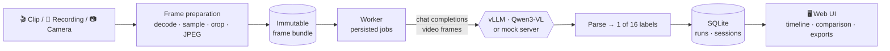

<div align="center">

# 🧍‍↘️ Fall Detection

**Video activity recognition with a vision-language model: analyze clips, replay recordings, or watch a live camera, and see a timestamped activity label for every window.**

[](https://github.com/MoritzM00/fall-detection-app/actions/workflows/ci.yml)


</div>

---

## What it does

This application turns the fall-detection research from the master's thesis (`fall-detection-mllm`) into an interactive tool. It samples timestamped frames from a video window, sends them to **Qwen3-VL-8B-Instruct** served by vLLM, and classifies what the person is doing into one of **16 activity labels**.

| Mode | What you do | What you get |
| --- | --- | --- |
| 🎬 **Clip analysis** | Upload a clip or pick a dataset video, choose a time window, tweak the prompt and sampling | The exact frames sent to the model, its raw answer, the parsed label, and side-by-side comparison of saved runs |
| 📼 **Recorded monitoring** | Replay a recording as if it were live | Successive windows at a configurable stride, a timestamped prediction timeline, and explicit coverage gaps |
| 📷 **Live camera** | Start your browser camera | The same windowed timeline, fed by frames captured in real time |

All three modes share one prediction pipeline. Every prediction keeps its input timestamps, the frames it saw, and the full configuration that produced it, so any result can be traced and reproduced.

### Activity labels

| Falls | Static postures | Transitions | Movement |
| --- | --- | --- | --- |
| `fall` · `fallen` | `standing` · `sitting` · `lying` · `kneeling` · `squatting` | `sit_down` · `stand_up` · `lie_down` · `kneel_down` · `squat_down` | `walk` · `crawl` · `jump` · `other` |

A processing failure is never reported as `other`. Failed, skipped or expired windows are recorded as such, with a reason.

## How it works



- **Frame preparation** decodes video with PyAV, keeps real frame timestamps, and writes the exact JPEGs the model will receive. The UI shows those same frames.
- **The worker** processes persisted jobs with leases and heartbeats. Interrupted work is recovered, and a model request is only repeated when you retry explicitly.
- **Inference backend** is either a real vLLM server or a local mock that speaks the same HTTP contract. The worker never silently falls back to the mock, and mock results are always labeled as simulated.
- **Exports and evaluation** produce JSON/CSV run and session records, plus an offline evaluation CLI that scores them against annotated intervals.

## Quick start

Requirements: Python 3.12+, [`uv`](https://docs.astral.sh/uv/), Node.js and pnpm. No GPU needed.

```bash
make setup   # install Python and web dependencies
make dev     # start web UI, API, worker and mock inference
```

Open **<http://localhost:5173>**, pick the synthetic sample or a local video, and run an analysis. Runtime state goes to the Git-ignored `data/` directory.

| Command | Purpose |
| --- | --- |
| `make check` | Lint, format check, type check, Python tests, web build and unit tests |
| `make browser-test` | End-to-end browser flows |
| `make demo` | Disposable CPU-only acceptance scenarios ([runbook](docs/runbook.md)) |

<details>
<summary><b>Configuration</b></summary>

| Variable | Effect |
| --- | --- |
| `MOCK_INFERENCE_LABEL` | Label the mock server returns (default `fall`) |
| `MOCK_INFERENCE_DELAY_MS` | Artificial mock latency |
| `FALL_DETECTION_BACKEND_KIND=vllm` | Use a real vLLM server instead of the mock |
| `FALL_DETECTION_INFERENCE_BASE_URL` | Base URL of the vLLM server |

Real inference needs a vLLM version that supports request-level video `media_io_kwargs`. Local OmniFall videos placed under `data/omnifall/videos` are discovered automatically; their `Fall`/`ADL` folder names are source groupings, not ground truth.

</details>

## Project status

> [!NOTE]
> Everything below runs end to end **against the mock inference server**. The real vLLM path is implemented but **not yet validated on the GPU server**, so no claims about model accuracy or research parity are made yet.

| Area | Status |
| --- | --- |
| Clip analysis, prompt editing, run comparison | ✅ Implemented |
| Recorded monitoring with replay controls and recovery | ✅ Implemented |
| Live browser camera ingest and capture | ✅ Implemented (raw-frame retention pending) |
| JSON/CSV exports and offline evaluation harness | ✅ Implemented |
| Deterministic mock scenarios and CPU demo | ✅ Implemented |
| Real GPU service validation | ⏳ Open: [#9](https://github.com/MoritzM00/fall-detection-app/issues/9), [#41](https://github.com/MoritzM00/fall-detection-app/issues/41) |
| Real-model continuous evaluation | ⏳ Open: [#42](https://github.com/MoritzM00/fall-detection-app/issues/42), tracked in [#43](https://github.com/MoritzM00/fall-detection-app/issues/43) |

## Repository layout

| Path | Responsibility |
| --- | --- |
| [`apps/web`](apps/web) | React/TypeScript interface |
| [`apps/api`](apps/api) | FastAPI upload, preparation, job and session API |
| [`apps/worker`](apps/worker) | Persisted-job worker that calls the inference backend |
| [`apps/mock_inference`](apps/mock_inference) | Local vLLM-compatible HTTP substitute |
| [`src/fall_detection`](src/fall_detection) | Shared taxonomy, sampling, prompts, inference client, parsing, persistence, monitoring and evaluation |
| [`deploy`](deploy/README.md) | Application and GPU serving configuration |
| [`tests`](tests/README.md) | Python test suite |

## Documentation

| | |
| --- | --- |
| 🏗️ [Architecture](docs/architecture.md) | Components and data flows |
| 🎯 [Product behavior](docs/product.md) | What each mode does and why |
| 📜 [Contracts](docs/contracts.md) · [Prepared video](docs/prepared-video.md) | API, data and vLLM payload contracts |
| 📼 [Monitoring](docs/monitoring.md) · 📷 [Live camera](docs/live-camera.md) | Windowing, scheduling and coverage |
| 📦 [Exports](docs/exports.md) · 📊 [Evaluation](docs/evaluation.md) | Run records and offline scoring |
| 🧪 [Mock inference](docs/mock-inference.md) · 🛠️ [Runbook](docs/runbook.md) | Local serving and GPU handoff |
| 🔬 [Research baseline](docs/research-baseline.md) | Relationship to the thesis research code |
| 🗺️ [Roadmap](docs/roadmap.md) · 🧭 [Decisions](docs/decisions.md) | Milestones and open questions |
